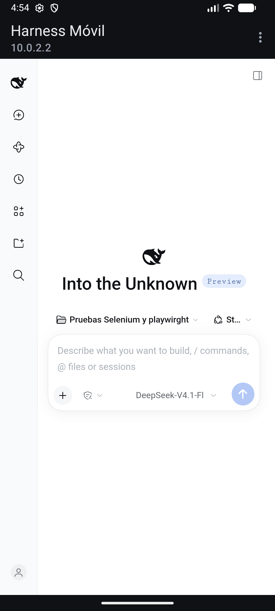

# Harness Móvil

Puente local entre tu PC con **DeepSeek Harness** y tu teléfono, en la misma red Wi‑Fi.
El agente, las herramientas y la escritura de archivos siguen corriendo en la PC; el teléfono
usa la interfaz web oficial de Harness con un emparejamiento y un interruptor de conexión propios.

```
Teléfono (PWA oficial de DSH)
   │  HTTPS/WSS  https://<ip-lan>:8443/
   ▼
[Puente Harness Móvil :8443  — único puerto expuesto a la LAN]
   ├─ /_hm/*        panel: emparejamiento, activar/desactivar, dispositivos
   ├─ auth de dispositivo (cookie propia, token hasheado en disco)
   ├─ proxy raíz    → 127.0.0.1:<puerto DSH>, Host/Origin normalizados, WebSocket
   └─ cookie de Harness en memoria (nunca se entrega al teléfono)
        │
        ▼
[dsh web --profile mobile --host 127.0.0.1 --port <libre> --no-open]
```

## Qué garantiza

- **Todas las funciones**: la UI oficial de Harness (chat, streaming, aprobaciones, plan/build,
  modelos, workspaces, tool calls, terminal, archivos) se sirve a través del puente, sin fork de la UI.
- **El token de lanzamiento y la cookie de Harness nunca salen de la PC.** El teléfono solo recibe
  una cookie de dispositivo emitida por el puente.
- **La conexión se activa y desactiva desde el teléfono** (o desde el panel de la PC). Desactivar
  apaga el host Harness y deja solo el panel; reactivar no requiere re‑emparejar.
- **Emparejamiento con QR o código de 6 dígitos**, un solo uso, TTL 5 minutos, rate limit y máximo
  de dispositivos configurable.
- **HTTPS con CA local** y un listener de administración que solo escucha en `127.0.0.1`.
- **Revocación por dispositivo** y apagado automático por inactividad (30 min por defecto).

## Requisitos

- Windows 10/11 (el puente usa `taskkill` y el CLI de escritorio; la lógica es portable).
- Node.js 22 o superior (probado con Node 26 y con el runtime 24.21 que trae DeepSeek Harness).
- DeepSeek Harness instalado en la PC (app de escritorio o CLI `dsh`). Versión probada: `dsh 0.2.1-rc.3`.
- PC y teléfono en la misma red Wi‑Fi/LAN.

## Instalación

```powershell
cd C:\Users\Matius\Desktop\DeepSeek\Harness_movil
npm install --ignore-scripts
npm run build
npm start
```

`npm start` ejecuta el servidor desde TypeScript con `tsx`. Para producción/autostart usá
`npm run start:built` (requiere `npm run build`).

El primer arranque crea:

```
%LOCALAPPDATA%\harness-movil\
  config.json        configuración editable
  devices.json       dispositivos emparejados (solo hashes)
  tls\               CA local + certificado del servidor
  logs\bridge.log    log JSON con secretos redactados
```

y muestra en consola el panel, la URL del teléfono, el código y el QR.

## Uso diario

### 1. Instalar la CA en el teléfono (una sola vez)

Con la PC y el teléfono en la misma Wi‑Fi, abrí en el teléfono:

```
https://<ip-lan>:8443/_hm/ca.cer
```

Aceptá la advertencia de certificado (todavía no confiás en la CA) y descargá el archivo.

- **Android**: Ajustes → Seguridad → Cifrado y credenciales → Instalar un certificado →
  Certificado de CA → elegí `harness-movil-ca.cer`. Chrome confía en las CA de usuario para navegar.
- **iPhone/iPad**: Safari descarga el perfil → Ajustes → Perfil descargado → Instalar → luego
  Ajustes → General → Información → Ajustes de confianza de certificados → activá la CA.

Después abrí `https://<ip-lan>:8443/_hm/` (sin advertencia).

### 2. Emparejar

En la PC abrí el panel local: `http://127.0.0.1:8444/_hm/`. Muestra el QR y el código.
En el teléfono:

- escaneá el QR (abre `/_hm/#p=...` y empareja solo), o
- abrí `https://<ip-lan>:8443/_hm/` y escribí el código de 6 dígitos.

### 3. Activar y usar

En el teléfono, tocá **Activar conexión**. El puente arranca un host Harness dedicado en la PC
(perfil `mobile`, mismo `$DSH_HOME`) y, cuando está listo, aparece **Abrir Harness**.

La UI oficial se abre en `/`. Para instalarla como app: menú del navegador → **Agregar a la
pantalla de inicio** (Harness ya trae `manifest` y `display: standalone`). El icono abre `/`;
si la conexión está inactiva, el puente redirige al panel.

### 4. App Android (APK opcional)

Si no querés usar el navegador, hay un envoltorio Android nativo en [`android/`](android/README.md):
WebView a pantalla completa con la misma UI oficial, escaneo del QR, subida de archivos, descargas
y pinning del certificado. **El build copia la CA de tu puente** (`%LOCALAPPDATA%\harness-movil\tls\ca.pem`)
al APK, así que no hay que instalar nada en Android. Si regenerás la CA, recompilá el APK (o usá
`-CaFile <ruta>`).

```powershell
powershell -ExecutionPolicy Bypass -File scripts\build-apk.ps1
adb install -r android\artifacts\HarnessMovil-0.1.0-debug.apk
```

El APK es de depuración (firmado con la clave debug, instalable). Para distribuirlo hace falta un
release firmado con tu keystore. Detalles y hoja de ruta: [`android/README.md`](android/README.md).



**Desactivar** detiene el host y deja el panel disponible. El apagado automático por inactividad
está en `activation.idleAutoOffMinutes` (0 lo desactiva).

### Sesiones y el aviso “This session is already in use”

Harness impone **un solo escritor vivo por sesión** (un lock de kernel). Si la app de escritorio tiene
una sesión abierta, otro proceso no puede escribir en ella y la UI muestra justamente ese aviso.

Para que el teléfono nunca choque, el host móvil usa por defecto su **propio directorio de sesiones**:
`$DSH_HOME/sessions-mobile` (modo `isolated`). El teléfono ve y crea su propio historial, separado del
de escritorio; credenciales, workspaces, skills y archivos siguen siendo los mismos.

Si preferís la **misma lista de sesiones** que la app de escritorio, cambiá en `%LOCALAPPDATA%\harness-movil\config.json`:

```json
{
  "dsh": { "sessions": "shared" }
}
```

y reiniciá el puente. En modo `shared`, una sesión que esté viva en escritorio seguirá bloqueada
hasta que la cierres ahí; las sesiones frías sí se pueden abrir en el teléfono (y quedan bloqueadas
para escritorio mientras el host móvil las tenga abiertas). El modo activo se muestra en el panel y
en `/_hm/api/status`.

El puente también copia la fila `agent-default-model` del perfil `desktop` al overlay del host móvil, para que el teléfono use el mismo proveedor/modelo que ya tenés funcionando en la app (por ejemplo `deepseek-account`), en lugar de una ruta de API key sin credencial válida.

## Panel de la PC (`http://127.0.0.1:8444/_hm/`)

- QR y código de emparejamiento (se renueva solo; botón **Generar código nuevo**).
- Activar/desactivar la conexión.
- Estado, puerto interno, uptime, certificado y diagnóstico.
- Dispositivos emparejados y revocación.

El listener de administración escucha solo en `127.0.0.1`; no se expone a la red.

## Configuración (`config.json`)

| Campo | Default | Descripción |
|---|---|---|
| `listen.host` | `auto` | IPv4 LAN a exponer (`auto` elige Wi‑Fi/Ethernet). Debe ser una IP literal o `auto`. |
| `listen.port` | `8443` | Puerto HTTPS de la LAN. |
| `listen.adminPort` | `port + 1` | Puerto HTTP del panel, solo loopback. |
| `publicHost` | `null` | Nombre DNS opcional para el certificado y las URLs. |
| `dsh.command` | `auto` | `auto` busca `dsh` en PATH y luego el CLI de la app de escritorio. |
| `dsh.profile` | `mobile` | Perfil de Harness que arranca el puente (se crea desde la plantilla `web`). |
| `dsh.home` | `null` | `$DSH_HOME` a usar; `null` = `DSH_HOME` del entorno o `~/.dsh`. |
| `dsh.sessions` | `isolated` | `isolated`: historial propio en `$DSH_HOME/sessions-mobile` (sin choques con escritorio). `shared`: usa `$DSH_HOME/sessions` y exige cerrar la sesión en escritorio. |
| `dsh.extraArgs` | `[]` | Argumentos extra para `dsh web`. |
| `dsh.startTimeoutMs` | `90000` | Espera máxima a que Harness imprima su URL con token. |
| `tls.mode` | `local-ca` | `local-ca` genera CA+hoja; `files` usa `certFile`/`keyFile`/`caFile`. |
| `pairing.codeTtlSeconds` | `300` | Vigencia del código/QR. |
| `pairing.maxDevices` | `3` | Dispositivos activos simultáneos. |
| `activation.autoStart` | `false` | Arrancar Harness al iniciar el puente. |
| `activation.idleAutoOffMinutes` | `30` | Apagado por inactividad; `0` desactiva. |
| `limits.pairingPerMinute` | `10` | Intentos de emparejamiento por IP y minuto. |

## Seguridad

- El puerto LAN habla **solo HTTPS** (TLS 1.2+). La CA y su clave viven en `tls\` con permisos de usuario.
- El host Harness escucha **solo en loopback**; el puente es la única superficie de red.
- El fence de `/api` de Harness se satisface con un `Host` loopback y sin `Origin`; el puente
  reescribe esas cabeceras y **nunca reenvía la cookie del teléfono** al upstream.
- Las respuestas de Harness no reenvían `Set-Cookie` al teléfono.
- El panel exige `Origin` correcto, cabecera `X-HM-CSRF`, cookies `HttpOnly; Secure; SameSite=Lax`
  y limita el cuerpo de las peticiones.
- **Un dispositivo emparejado es owner pleno** de Harness (por diseño: todas las funciones).
  Revocá dispositivos que ya no uses.
- Si la IP LAN cambia, el certificado y la URL cambian; volvé a emparejar (la cookie es host‑only).
  Para evitarlo, fijá una IP reservada en el router o usá `publicHost` con DNS local.

Más detalle: [SECURITY.md](docs/SECURITY.md), [RUNBOOK.md](docs/RUNBOOK.md).

## Firewall y arranque automático

Con una consola **como administrador**:

```powershell
powershell -ExecutionPolicy Bypass -File scripts\firewall.ps1          # abre 8443 solo en redes privadas
powershell -ExecutionPolicy Bypass -File scripts\install-task.ps1      # tarea al iniciar sesión
powershell -ExecutionPolicy Bypass -File scripts\uninstall-task.ps1    # quitar la tarea
```

Opcional: `scripts\start-hidden.vbs` arranca el puente sin ventana de consola.

## Pruebas y métricas

```powershell
npm test            # compila pruebas y ejecuta node:test
npm run test:coverage
npm run dup         # jscpd: duplicación
npm run metrics     # ambas
```

- 98 pruebas (unitarias + integración con upstream falso HTTP/WS + router completo).
- Cobertura del código fuente: **90.7 % de líneas, 80.7 % de ramas y 90.8 % de funciones** (reporte de Node con `--experimental-test-coverage`).
- Duplicación (jscpd, `minLines 5`, `minTokens 50`): **0 %**.
- Android: **9 pruebas JVM** (gradlew testDebugUnitTest); el wrapper no tiene cobertura instrumentada (validación E2E manual en emulador).
- Duplicación Java (jscpd): **0 %** (4 archivos, 762 líneas).

El runner es `node:test` con un shim mínimo compatible con la API de Vitest
(`apps/bridge/tests/helpers/testkit.ts`). Motivo: el sandbox de archivos de DeepSeek Harness
bloquea el `spawn` que Vite/esbuild necesita; `node:test` con `--test-isolation=none` corre en un
solo proceso sin hijos.

## Estructura

```
apps/bridge/
  src/config.ts        configuración validada y resolución de LAN/puertos
  src/tls.ts           CA local + certificado con SAN de IP/hostname
  src/devices.ts       registro de dispositivos (hash, revocación)
  src/pairing.ts       tickets de un solo uso (código + secreto QR)
  src/dsh.ts           detección del CLI, spawn, parseo del token, parada en árbol
  src/jar.ts           intercambio del token y cookie jar de Harness (memoria)
  src/activation.ts    estados inactive/starting/active/stopping/error + idle
  src/proxy.ts         proxy HTTP/WS raíz (Host/Origin/cookies)
  src/auth.ts          cookies, same-origin, CSRF, rate limit, body
  src/dashboard.ts     panel /_hm y sus endpoints
  src/http.ts          router: dashboard, gates y proxy
  src/main.ts          servidores LAN (HTTPS) y admin (HTTP loopback), QR, shutdown
  public/              panel (HTML/CSS/JS sin build)
  tests/               98 pruebas + upstream falso + shim node:test
scripts/               firewall, tarea de inicio, lanzador oculto, build-apk
docs/                  seguridad, runbook y ADR
android/               app Android (WebView nativo, QR, pinning de certificado)
```

## Limitaciones conocidas (v1)

- **No se acopla a la sesión viva de la app de escritorio.** El host móvil es otro proceso sobre el
  mismo `$DSH_HOME`, pero por defecto usa un historial de sesiones aislado (`sessions-mobile`) para
  no chocar con el lock de escritura de la app de escritorio. Con `dsh.sessions: "shared"` comparte la
  lista, pero una sesión abierta en escritorio no puede estar viva en ambos a la vez: cerrala ahí
  antes de usarla en el teléfono.
- Solo LAN/Wi‑Fi. Fuera de casa requeriría Tailscale/Cloudflare Tunnel (no incluido).
- Sin notificaciones push ni service worker; la UI reconecta sola al volver a primer plano.
- Sin APK nativa: la app es la PWA oficial instalada desde el navegador.
- Si la PC se suspende, el teléfono no la despierta.
